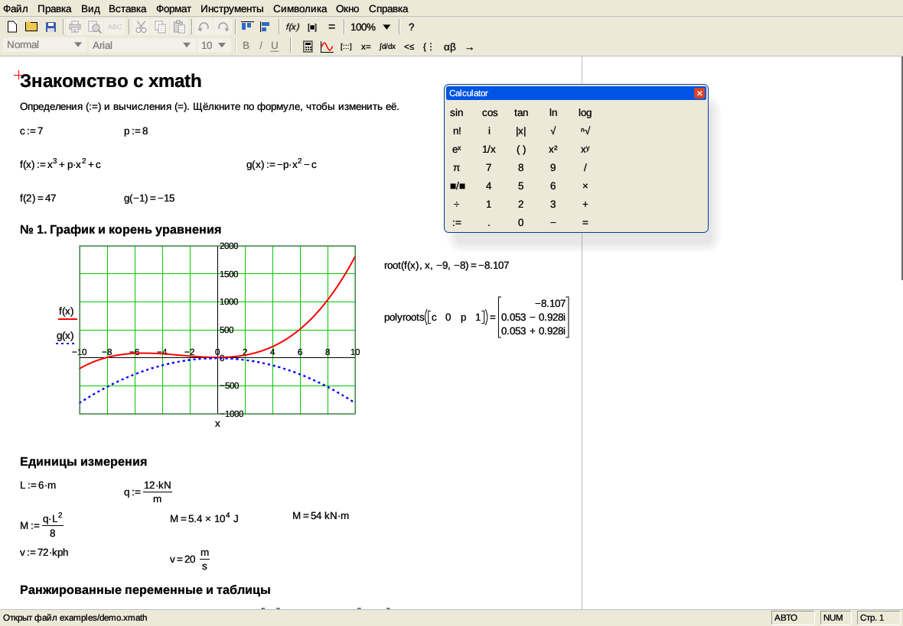

# xmath


**xmath** — свободная программа с открытым исходным кодом для инженерных и научных расчётов,
альтернатива **Mathcad 15** (классической версии с меню, панелями инструментов и плавающими палитрами,
а не Mathcad Prime). Работает на Linux, Windows и macOS. Написана на Rust.

> Статус: **alpha**. Ядро расчётов работает, интерфейс и совместимость с Mathcad 15 активно дорабатываются.



## Возможности

- Единицы измерения с автоматической проверкой размерностей (`m`, `kg`, `s`, `N`, `kN`, `Pa`, `MPa`, `J`, `W` …).
- Пользовательские функции, диапазонные переменные, векторы и матрицы.
- Численные интегралы, производные, поиск корней, суммы и произведения.
- Графики X-Y.
- Интерфейс в стиле Mathcad 15: меню, панели инструментов, палитры
  Calculator, Graph, Matrix, Evaluation, Calculus, Boolean, Programming, Greek, Symbolic.
- Импорт файлов Mathcad 15 (`.xmcd`); собственный формат `.xmath` (JSON).
- MCP-сервер и навык (skill) для ИИ-ассистентов: любая нейросеть с поддержкой MCP может считать,
  создавать и править рабочие листы.

### Что уже работает, а что в разработке

| Возможность | Состояние |
|---|---|
| Свободное размещение областей, порядок вычислений сверху вниз и слева направо | ✅ |
| Определения `:=`, глобальные `≡`, вычисление `=`, вывод в заданных единицах | ✅ |
| Единицы измерения и проверка размерностей | ✅ |
| Комплексные числа, матрицы, ранжированные переменные, таблицы | ✅ |
| Интегралы, производные, `root`, `polyroots`, суммы/произведения | ✅ |
| ~150 встроенных функций (линейная алгебра, статистика, сплайны, регрессия, Бессель, ОДУ `rkfixed`) | ✅ |
| Двумерная отрисовка формул (дроби, степени, корни, интегралы, матрицы) | ✅ |
| X-Y графики | ✅ |
| Меню, панели инструментов, палитры, диалоги «Вставить функцию/матрицу/единицы», «Формат результата» | ✅ |
| Импорт `.xmcd` (Mathcad 15) | ✅ базовый, см. [docs/xmcd-import.md](docs/xmcd-import.md) |
| MCP-сервер и навык для ИИ | ✅ |
| Программирование (`←`, `if`, `for`, `while`…) | 🚧 в работе |
| Блоки решения `Given`/`Find`/`Minerr` | 🚧 в работе |
| Температурные единицы °C/°F, ~250 единиц, системы единиц СГС/US | ✅ (выбор системы в GUI — в работе) |
| Символьные вычисления `→` | ⏳ запланировано |
| Полярные и 3D-графики, печать/PDF, экспорт в `.xmcd` | ⏳ запланировано |

## Установка

Одна команда (нужны `git`, `curl` и компилятор C; Rust будет предложено установить автоматически):

```bash
curl -fsSL https://raw.githubusercontent.com/t1murjan/xmath/main/install.sh | bash
```

Обновление:

```bash
curl -fsSL https://raw.githubusercontent.com/t1murjan/xmath/main/install.sh | bash -s -- update
```

Удаление:

```bash
curl -fsSL https://raw.githubusercontent.com/t1murjan/xmath/main/install.sh | bash -s -- uninstall
```

Или, если репозиторий уже склонирован: `./install.sh [install|update|uninstall]`.
Полезные параметры: `--branch <имя>`, `--repo <url>`, `--prefix <каталог>` (по умолчанию `~/.local`),
`--from-local` (сборка из текущего каталога), `--with-skill`, `--force`, `--purge`, `-y`, `-h`.
Если `~/.local/bin` нет в `PATH`, скрипт подскажет строку для `~/.bashrc`.

Для графического приложения на Linux нужны обычные библиотеки рабочего стола (`libxkbcommon-x11`, `libGL`,
поддержка Wayland или X11) — на настольных дистрибутивах они уже установлены. На сервере без графики
(или для ИИ-ассистентов) достаточно `xmath-cli` и `xmath-mcp`.

Пока ветка разработки не влита в `main`, можно ставить из неё: `--branch <имя-ветки>`.

Ручная сборка:

```bash
git clone https://github.com/t1murjan/xmath.git
cd xmath
cargo build --release
./target/release/xmath        # графическое приложение
./target/release/xmath-cli файл.xmath
```

## Использование

### Синтаксис

| Запись | Значение |
|---|---|
| `x := 5 m` (клавиша `:`) | присваивание |
| `f(x) := x^2` | определение функции |
| `g ≡ 9.81` (клавиша `~`) | глобальное определение |
| `i := 0..10` (клавиша `;`) | диапазон |
| `v[i] := i^2` | элемент вектора |
| `d := a/b =`, `d := a/b = мкм` | определение с выводом значения (как `d := a/b = 69,6 мкм` в Mathcad) |
| `[a; b; c] := M*v` | векторное определение: каждому имени присваивается элемент вектора |
| `M^<j>` | столбец матрицы `M⟨j⟩` (Ctrl+6), нумерация от `ORIGIN` |
| `vectorize(v*w)` | векторизация (стрелка над выражением, Ctrl+-): всё внутри выполняется поэлементно, скаляры растягиваются |
| `sum(i, expr)` | сумма по дискретной переменной `i` (Σ с одним индексом) |
| `expr =` | вычислить выражение |
| `F = kN` | вывести результат в kN |
| `[1, 2; 3, 4]` | матрица |
| `\|x\|`, `n!`, `2i` | модуль, факториал, комплексная единица |
| `sum(k, 1, n, k^2)` | сумма |
| `integrate(f(x), x, 0, ∞)` | интеграл |
| `diff(f(x), x)` | производная |
| `root(f(x), x, a, b)` | корень на отрезке |
| `if(c, a, b)` | условие |

#### Программы (палитра «Программирование»)

Программа Mathcad записывается в одну строку в фигурных скобках; операторы разделяются `;`
(в Mathcad это столбец строк с вертикальной чертой слева — xmath рисует её так же).
Программа — обычное выражение: ею можно определять переменные и функции.

| Запись | Значение |
|---|---|
| `x ← expr` (или `x <- expr`), `v[i] ← expr` | локальное присваивание (локальные имена затеняют переменные листа) |
| `for i ∈ 1..n { ... }` (или `for i in 1..n`) | цикл по диапазону или вектору |
| `while условие { ... }` | цикл с условием |
| `if условие { ... } otherwise { ... }` (также `else`, `else if`) | ветвление |
| `return -1 if x < 0` | оператор с условием в стиле Mathcad (`stmt if условие`) |
| `break`, `continue`, `return expr` | управление циклом / досрочный выход |
| `expr1 on error expr2` | значение `expr2`, если вычисление `expr1` завершилось ошибкой |

Подряд идущие `if` образуют цепочку: `otherwise` выполняется, только если не сработал ни один предыдущий `if` цепочки
(`{ a if x < 0; if x >= 0 and x < 5 { b } otherwise { c } }`).

Значение программы — значение последнего выполненного оператора (или `return`).
Предел числа итераций цикла — 10 000 000 за один запуск программы.

```
f(n) := { s ← 0; for i ∈ 1..n { s ← s + i^2 }; s }
g(x) := { return -1 if x < 0; sqrt(x) }
h(x) := { if x < 0 { "neg" } else if x == 0 { "zero" } otherwise { "pos" } }
k(x) := { y ← 1/x on error 0; y }
w(a) := { i ← 0; while i < a { i ← i + 1; if i == 5 { break } }; i }
```

Пример: `examples/programs.xmath`. Программы из `.xmcd` (Mathcad 15) импортируются в этот же синтаксис.
Сравнение с отрицательным числом пишите с пробелом: `a < -1` (запись `a<-1` читается как присваивание `←`).

Единицы: `m kg s N kN Pa MPa J W …`. Как в Mathcad: `gm` — грамм, `g` — ускорение свободного падения.

Как и в Mathcad: щёлкните на пустом месте листа (появится красный крестик) и печатайте — создастся
математическая область; `"` создаёт текстовую область, `@` — график. Щелчок по формуле открывает её для
правки, `Enter` завершает ввод. Области можно перетаскивать мышью, выделять рамкой и выравнивать.

### Горячие клавиши

| Клавиши | Действие |
|---|---|
| `:` | `:=` |
| `~` | `≡` |
| `=` | вычислить |
| `;` | `..` (диапазон) |
| `\` | √ |
| `\|` | модуль |
| `?` | производная |
| `&` | интеграл |
| `$` | сумма по диапазону |
| `#` | произведение |
| `Ctrl+=` | булево равно |
| `Ctrl+3` / `Ctrl+9` / `Ctrl+0` | `≠` / `≤` / `≥` |
| `Ctrl+G` | греческая буква |
| `Ctrl+M` | вставить матрицу |
| `Ctrl+E` | вставить функцию |
| `Ctrl+U` | вставить единицу |
| `@` | график X-Y |
| `"` | текстовая область |
| `Tab` | следующий placeholder ■ |
| `F9` | пересчитать |
| `Ctrl+Z` / `Ctrl+Y` | отмена / повтор |
| `Ctrl+N` / `Ctrl+O` / `Ctrl+S` | новый / открыть / сохранить |
| `F1` | справка |

### Командная строка

```bash
xmath-cli пример.xmath                       # вычислить лист и напечатать результаты
xmath-cli расчёт.txt                         # по одной формуле на строку, строки с # — текст
xmath-cli старый.xmcd --convert новый.xmath   # импорт из Mathcad 15
```

Примеры рабочих листов — в каталоге [examples/](examples) (также «Файл → Примеры» в программе).

## Единицы измерения

Единицы как в Mathcad 15: `5 kN`, `12 kN/m`, `210 GPa`, `72 km/hr`; результат автоматически
приводится к СИ и упрощается до производной единицы (`N`, `Pa`, `J`, `W`, `V`, `Ω`, ...), а
`expr = unit` показывает его в нужной единице (`M = kN*m`, `σ = MPa`, `p = kgf/cm^2`).
Температура: `K`, `R` - абсолютные; `°C`, `°F` - со смещением (`T := 25 °C` хранит 298.15 K,
`T = °C` показывает 25, `T = °F` - 77); `Δ°C`, `Δ°F` - разности (`T + 10 Δ°C`). Систему единиц
отображения (СИ / MKS / CGS / U.S.) задаёт параметр `unit_system` в `format` файла.
Подробности: [docs/units.md](docs/units.md).

## ИИ и MCP

xmath сделан так, чтобы им могла пользоваться любая нейросеть. Для этого есть две части:

- **MCP-сервер `xmath-mcp`** (stdio, JSON-RPC). Инструменты: `evaluate` (посчитать формулы), `open_worksheet`,
  `create_worksheet`, `add_region`, `update_region`, `delete_region`, `list_functions`, `list_units`, `syntax_help`.
- **Навык (Agent Skill) [skills/xmath](skills/xmath/SKILL.md)** — объясняет модели синтаксис, единицы,
  типичные ошибки и порядок работы. Если MCP недоступен, навык учит пользоваться `xmath-cli`.

Подключение:

```bash
claude mcp add xmath -- ~/.local/bin/xmath-mcp      # Claude Code
./install.sh --with-skill                           # установить навык в ~/.claude/skills/xmath
```

Claude Desktop, Cursor и другие MCP-клиенты подключаются через `command: "xmath-mcp"` —
готовые конфиги в [docs/mcp.md](docs/mcp.md).

## Устройство проекта

| Каталог | Что внутри |
|---|---|
| `crates/xmath-core` | вычислительное ядро без GUI: парсер, единицы, вычислитель, численные методы, формат `.xmath`, импорт `.xmcd` |
| `crates/xmath-gui` | настольное приложение `xmath` (egui): интерфейс Mathcad 15 |
| `crates/xmath-cli` | `xmath-cli` — расчёт листа из командной строки |
| `crates/xmath-mcp` | `xmath-mcp` — MCP-сервер для ИИ |
| `skills/xmath` | навык для ИИ-моделей |
| `examples/` | примеры рабочих листов |
| `install.sh` | установка, обновление и удаление |

## Планы

- Блоки решения `Given`/`Find`
- Символьный движок (`→`, simplify, solve, factor…)
- Полярные и 3D-графики
- Редактирование формул прямо в двумерном виде (как в Mathcad), а не в строке
- Экспорт в `.xmcd`, печать и экспорт в PDF

## Участие в разработке

См. [CONTRIBUTING.md](CONTRIBUTING.md).

## Лицензия

MIT OR Apache-2.0 — на выбор ([LICENSE-MIT](LICENSE-MIT), [LICENSE-APACHE](LICENSE-APACHE)).

---

## English summary

**xmath** is a free, open-source clone of Mathcad 15 (the classic UI, not Prime) written in Rust for
Linux, Windows and macOS. Alpha status. It features unit-aware calculations with dimension checking,
functions, ranges, matrices, numeric integrals/derivatives/roots, X-Y plots, a Mathcad-15-style interface
with palettes, `.xmcd` import, and an MCP server for AI assistants.
Install: `curl -fsSL https://raw.githubusercontent.com/t1murjan/xmath/main/install.sh | bash`
(also supports `update` and `uninstall`). Licensed under MIT OR Apache-2.0.
